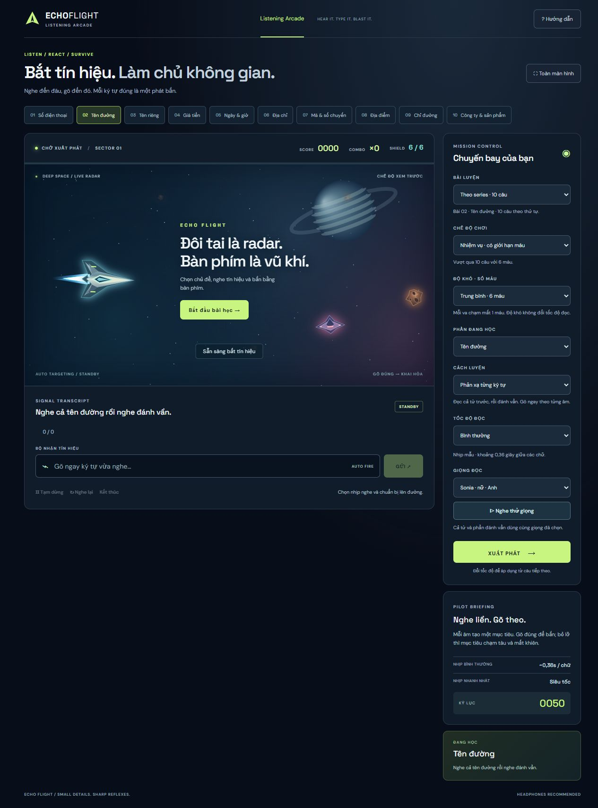

# Echo Flight

A spaceship arcade for practising the tiny details in English listening: names, numbers, dates, prices and spelling. Hear the signal, type the answer and shoot the incoming target.



## Play locally

Open **[index.html](index.html)** in Chrome or Edge. No account, API key or installation is required. All speech audio is bundled with the game; web fonts have a system-font fallback.

For a local development server, use Node.js 20 or later:

```sh
npm run dev
```

Open the printed address, normally `http://127.0.0.1:8765`. Set `PORT` to choose another local port.

## Learn in short, structured sessions

The **10 topic lessons each contain 10 ordered questions**:

| Topic                  | What you practise                                    |
| ---------------------- | ---------------------------------------------------- |
| Phone numbers          | Digits, number groups, double and triple             |
| Street names           | Complete name, grouped spelling and a repeated name  |
| Personal names         | Similar-sounding names and precise spelling          |
| Prices                 | Amounts, including fifteen/fifty and sixteen/sixty   |
| Dates and times        | Calendar dates and different ways of saying the time |
| Addresses              | House, apartment and room numbers                    |
| Codes and travel       | Letter-number codes, flights and platforms           |
| Places                 | Stations, airports, cities and hotels                |
| Directions             | Position, distance and direction phrases             |
| Companies and products | Unfamiliar technology names                          |

Choose an ordered lesson, a random five-question session, or endless survival. Reports show each answer, whole-question accuracy and letter accuracy. **Review mistakes** replays attempted questions answered incorrectly, without health loss. Unattempted questions are not marked wrong. Lesson progress and settings are stored locally in your browser.

### Three ways to listen

- **Immediate reaction:** hear the complete word/name, pause briefly, then type along with grouped spelling. Each sound has its own target and deadline. A missed letter does not shift the remaining answers.
- **Whole answer:** listen and enter the entire answer, then press Enter or Fire. Common phone-number separators and equivalent price formats are accepted.
- **Memory:** hear the word and spelling, then enter the complete answer after playback.

Some subjects, including prices and directions, use complete answers.

### Choose your challenge

| Difficulty       | Health |
| ---------------- | -----: |
| Easy             |     10 |
| Medium (default) |      6 |
| Hard             |      3 |

Difficulty changes health independently from reading speed. **Practice** never loses health. **Mission** ends when the lesson is complete or health runs out. **Survival** continues until health runs out.

Reading speed has six named levels: Very slow, Slow, Normal, Fast, Very fast and Turbo. Changes apply from the next question. Normal uses roughly 0.36 seconds between ordinary letters, with pauses between groups and words; W has extra articulation time.

### Consistent speech

Choose **Sonia** (female, British English) or **Ryan** (male, British English), and use Preview voice to compare them. Whole words, letters and digits always use the selected neural voice. Audio variants preserve pitch at each supported speed. The game plays local audio, rather than requesting an online speech service during play.

The lesson format and cadence were informed by [this IELTS street-name listening reference](https://www.youtube.com/watch?v=QrOmh-IfGg4&t=208s). Lesson content is the game's own practice material. The reference video's audio is not included, and the original speaker's voice is not cloned.

## Controls and feedback

- The target with the **green ring** is the next one to answer; its shrinking arc shows remaining time.
- Correct input fires automatically in reaction mode. Use Enter or Fire for whole answers.
- **Esc** pauses/resumes. Opening Help pauses an active flight; closing it does not resume automatically.
- Switching tabs pauses playback and prevents offscreen damage.
- Replay continues from an unresolved character. It does not restore health.
- Built-in guidance and a launch button are available directly in the flight scene.
- Motion respects the operating system's reduced-motion preference. Gameplay timing stays consistent across frame rates.

## Development and verification

The application is plain HTML, CSS and JavaScript, with no framework or build step. Runtime scripts and generated voice banks are at the repository root. Voice banks are generated data and intentionally remain compact.

```sh
npm ci
npm test
npm run format:check
```

| Tests                     | Coverage                                                                                                                |
| ------------------------- | ----------------------------------------------------------------------------------------------------------------------- |
| `tests/game.test.cjs`     | Ordered lessons, scoring, health boundaries, answer formats, pause/help, preferences, progress and mistake review       |
| `tests/audio.test.cjs`    | 432 non-silent letter/digit clips, 208 phrases, coverage, cancellation and voice isolation during asynchronous decoding |
| `tests/renderer.test.cjs` | Delayed-frame explosions, single hit resolution, consistent steering, pause and reduced effects                         |

`npm run format` formats source files. GitHub Actions runs the same checks for pushes and pull requests. Browser checks cover real playback progress, both voice previews, lesson scoring and the result report; automated checks do not rate perceived voice naturalness.

## Project layout

- `game.js` — lesson/session state and input handling.
- `rhythm.js` — grouped audio timing, playback and voice caches.
- `space.js` — canvas ships, targets, particles and camera feedback.
- `courses.js`, `lessons.js` — ordered lessons and practice content.
- `voice-sonia.js`, `voice-ryan.js` — bundled speech banks.
- `scripts/serve.mjs` — local static preview.

Progress and preferences are stored locally. Answers are processed in the browser. There is no account system, backend or analytics.
