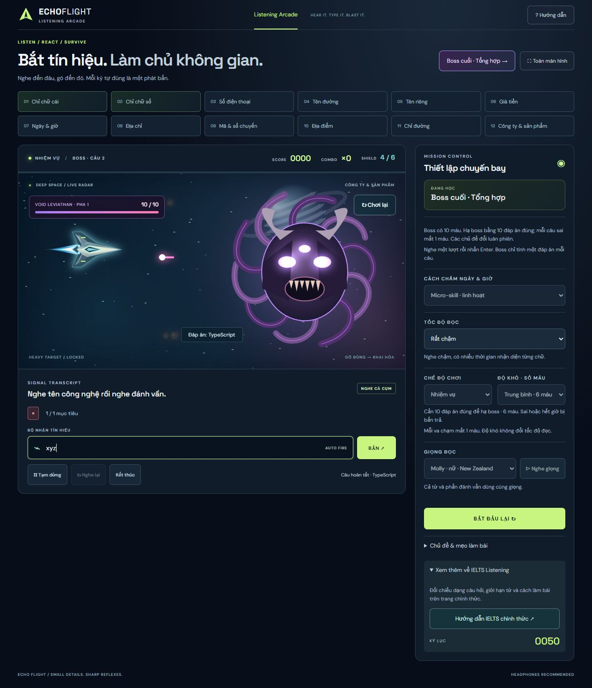

# Echo Flight

A spaceship arcade for practising the tiny details in English listening: names, numbers, dates, prices and spelling. Hear the signal, type the answer and shoot the incoming target.


## Play locally

Open **[index.html](index.html)** in Chrome or Edge. No account, API key or installation is required. All speech audio is bundled with the game; web fonts have a system-font fallback.

For a local development server, use Node.js 20 or later:

```sh
npm run dev
```

Open the printed address, normally `http://127.0.0.1:8765`. Set `PORT` to choose another local port.

## Learn in short, structured sessions

The **420 questions are divided into 42 ordered lessons of 10**, across 10 topics. Street names and personal names each have five lessons; the other topics each have four. Choose a lesson within any topic, and use **Next lesson** after the report to continue.

| Topic                  | What you practise                                    |
| ---------------------- | ---------------------------------------------------- |
| Phone numbers          | Digits, number groups, double and triple             |
| Street names           | Complete name, grouped spelling and a repeated name  |
| Personal names         | Similar-sounding names and precise spelling          |
| Prices                 | Amounts, including fifteen/fifty and sixteen/sixty   |
| Dates and times        | Calendar dates and different ways of saying the time |
| Addresses              | House, apartment and room numbers                    |
| Codes and travel       | Letter-number codes, flights and platforms           |
| Places                 | Stations, airports, cities and hotels                |
| Directions             | Position, distance and direction phrases             |
| Companies and products | Unfamiliar technology names                          |

Choose an ordered lesson, a random five-question session, or endless survival. Random questions are drawn without repetition until the topic's pool is exhausted, including across sessions; the cycle boundary avoids an immediate repeat. Reports show each answer, whole-question accuracy and letter accuracy. **Review mistakes** replays attempted questions answered incorrectly, without health loss. Unattempted questions are not marked wrong. Each lesson has its own progress record, saved locally with settings and selected pages.

### Continuous character training

Two additional sections are **Letters only (A–Z)** and **Digits only (0–9)**. They never mix the two character sets. Choose a fresh random sequence of **60, 120 or 240 characters**, or **Endless**. Each sound is followed by time to type, with no between-question screens. The spaceship and automatic shooting stay active throughout.

| Character-drill speed | Time between sounds | Approximate characters/minute |
| --------------------- | ------------------: | ----------------------------: |
| Very slow             |         2.4 seconds |                            25 |
| Slow                  |         1.8 seconds |                            33 |
| Normal                |         1.2 seconds |                            50 |
| Fast                  |        0.85 seconds |                            71 |
| Very fast             |         0.6 seconds |                           100 |
| Turbo                 |         0.4 seconds |                           150 |

These are practice levels, not official IELTS timing standards. Very slow through Fast use the original recordings without time compression and add silence for typing; the two fastest levels use shorter pitch-preserving variants. Each target's deadline matches the next sound. **Preview rhythm** plays N–M–N–L for letters or 1–5–9–1 for digits at the chosen interval. N was re-recorded from the actual letter `N.` in both voices, replacing the ambiguous text token `en`.

Use Practice for unlimited health, Mission for the selected length with limited health, or Survival for an endless challenge. Pause, replay and speed changes preserve the unresolved sequence, score and health. Speed changes take effect immediately in these two sections. The report shows overall accuracy and hits/misses for each character. Endless training retains a small rolling event queue rather than accumulating the entire session in memory.

### Three ways to listen

- **Immediate reaction:** hear the complete word/name, pause briefly, then type along with grouped spelling. Each sound has its own target and deadline. A missed letter does not shift the remaining answers.
- **Whole answer:** listen and enter the entire answer, then press Enter or Fire. Common phone-number separators are accepted. Price answers follow the unit shown in the question.
- **Memory:** hear the word and spelling, then enter the complete answer after playback.

Some subjects, including prices and directions, use complete answers.

### Prices and IELTS answer formats

Price practice offers two forms. When the question supplies **Price: £ \_\_\_\_**, enter only the missing number, such as `15.50`; the game displays the currency outside the input. When it supplies **Price: \_\_\_\_**, include the unit: `£15.50` or `15.50 pounds`. The second form specifies **NO MORE THAN ONE WORD AND/OR A NUMBER**. Missing units and the wrong currency are rejected. A £ insertion button is a game aid for keyboards without that symbol.

Real IELTS answers depend on the actual question and word limit. [IDP's punctuation and number guidance](https://ielts.idp.com/prepare/article-fixing-common-punctuation-and-number-mistakes//) advises including the currency symbol when the question does not supply it; [British Council's practice answer key](https://takeielts.britishcouncil.org/sites/default/files/listening_test_2_new_answers.pdf) gives currency answers with a symbol or the word _pounds_. Always follow the [official completion-task instructions](https://ielts.org/take-a-test/test-types/ielts-academic-test/ielts-academic-format-listening), including the stated word/number limit. The game models these two forms rather than reproducing the IELTS computer interface.

Fractional prices use a full stop and two decimal places, following IDP's recommended format: `15.50`, rather than `15,50` or `15.5`. Whole amounts such as `50` are also accepted.

### Dates, times and official guidance

**Micro-skill · flexible** compares the meaning: `half past six`, `six thirty`, `6:30` and `06.30` match; `13 March`, `March 13th` and `the thirteenth of March` match. Ambiguous numeric dates such as `03/04` need a month name. **Follow question limits** shows a practice instruction and checks it as well: clock times require a numeric response, and dates allow up to three words and/or a number. The flexible mode builds listening accuracy; the instructions on a real IELTS question determine which answer forms fit it.

Open **Xem thêm về IELTS Listening** in the settings to read the [official IELTS Listening format](https://ielts.org/take-a-test/test-types/ielts-academic-test/ielts-academic-format-listening). It covers the four parts, question types, answer limits, and British, Australian, New Zealand and North American accents. [IDP's number guide](https://ielts.idp.com/prepare/article-fixing-common-punctuation-and-number-mistakes//) also illustrates equivalent numeric time punctuation such as a colon and a full stop.

### Choose your challenge

| Difficulty       | Health |
| ---------------- | -----: |
| Easy             |     10 |
| Medium (default) |      6 |
| Hard             |      3 |

Difficulty changes health independently from reading speed. **Practice** never loses health. **Mission** ends when the lesson is complete or health runs out. **Survival** continues until health runs out.

### Final boss: Void Leviathan



Launch **Boss cuối · Tổng hợp** from the heading or a completed lesson's report. The boss has ten health and three visual phases. The deck rotates through all ten topic categories, shuffled each cycle. Hear each question once (including spelling where appropriate), then submit one complete answer. Each correct submission fires one laser and removes one boss health; a wrong submission or timeout launches one counterattack and removes one player shield. The fight ends when either side runs out of health.

Reading speed has six named levels: Very slow, Slow, Normal, Fast, Very fast and Turbo. Changes apply from the next question in topic lessons, and immediately in continuous character training. Normal uses roughly 0.36 seconds between ordinary letters, with pauses between groups and words in topic lessons; W has extra articulation time.

### Consistent speech

Choose from **seven neural voices across four accents**: Sonia and Ryan (UK), Jenny and Guy (US), Natasha and William (Australia), and Molly (New Zealand). Preview voice lets you compare them. Whole words, letters and digits use the same selected voice. The additional banks load from the local game files only when chosen, and audio variants preserve pitch. Playback makes no requests to a speech service.

The lesson format and cadence were informed by [this IELTS street-name listening reference](https://www.youtube.com/watch?v=QrOmh-IfGg4&t=208s). Lesson content is the game's own practice material. The reference video's audio is not included, and the original speaker's voice is not cloned.

## Controls and feedback

- The target with the **green ring** is the next one to answer; its shrinking arc shows remaining time.
- Correct input fires automatically in reaction mode. Use Enter or Fire for whole answers.
- **Esc** pauses/resumes. Opening Help pauses an active flight; closing it does not resume automatically.
- Switching tabs pauses playback and prevents offscreen damage.
- Replay continues from an unresolved character. It does not restore health.
- Built-in guidance and a launch button are available directly in the flight scene.
- **Play again** is available directly on the flight scene during play and as a large central button at the end of a session.
- Motion respects the operating system's reduced-motion preference. Gameplay timing stays consistent across frame rates.

## Development and verification

The application is plain HTML, CSS and JavaScript, with no framework or build step. Runtime scripts and generated voice banks are at the repository root. Voice banks are generated data and intentionally remain compact.

```sh
npm ci
npm test
npm run format:check
```

| Tests                     | Coverage                                                                                                                                       |
| ------------------------- | ---------------------------------------------------------------------------------------------------------------------------------------------- |
| `tests/game.test.cjs`     | Ordered lessons, scoring, health boundaries, answer formats, pause/help, preferences, progress and mistake review                              |
| `tests/drills.test.cjs`   | Strict character sets, finite goals, 24,000+ endless characters, bounded memory, pause/speed, no-repeat draws and all 42 lessons               |
| `tests/audio.test.cjs`    | 1,764 letter/digit clips and 2,730 phrases across seven voices, non-overlapping drill speech, source cleanup, cancellation and voice isolation |
| `tests/renderer.test.cjs` | Delayed-frame explosions, single hit resolution, consistent steering, pause and reduced effects                                                |

`npm run format` formats source files. GitHub Actions runs the same checks for pushes and pull requests. Browser checks cover real playback progress, both voice previews, lesson scoring and the result report; automated checks do not rate perceived voice naturalness.

## Project layout

- `game.js` — lesson/session state and input handling.
- `rhythm.js` — grouped audio timing, playback and voice caches.
- `drills.js` — continuous, strictly separated letter/digit streams.
- `questions.js` — persistent random question bags without repeats.
- `space.js` — canvas ships, targets, particles and camera feedback.
- `courses.js`, `lessons.js`, `content.js` — 42 ordered lessons and expanded practice content.
- `voice-sonia.js`, `voice-ryan.js`, `voice-*-extra.js` — bundled speech banks.
- `scripts/serve.mjs` — local static preview.

Progress and preferences are stored locally. Answers are processed in the browser. There is no account system, backend or analytics.
